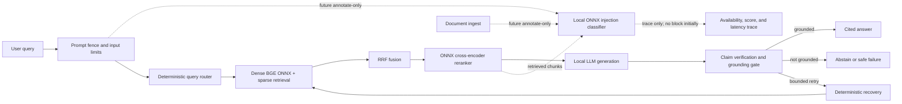

# TrustRAG Multi-Model Architecture Review

**Date:** 2026-11-05  
**Decision status:** proposal only. No model, dependency, configuration, or application change is approved by this report.  
**Production constraint:** local-only inference, with no required external API, cloud inference, or data egress.  
**Product posture:** English-first; Hindi and broader multilingual support must be evaluated before any production-language claim.

## Executive decision

**Keep the current minimal multi-model pipeline. Do not introduce Laya, a larger reranker, or an NLI replacement into the request path.**

The recommended architecture is:

1. Keep the current local BGE embedding model, sparse retrieval, RRF fusion, ONNX cross-encoder reranker, local answer model, claim verification, grounding gate, abstention, and bounded recovery.
2. Complete the already-corrected evaluation instrumentation and create a labeled security corpus before adding a learned guardrail.
3. If that evidence identifies a material injection-detection gap, run **Horizon Prompt Injection Guard Small** as a **local ONNX, annotate-only pilot**. It must reuse TrustRAG's ONNX session factory and never become the sole safety control.
4. Defer Laya until observed decision traces and labels show that the deterministic router or recovery policies leave measurable quality on the table.

This is a deliberately small architecture: each existing model has a distinct job, and no proposed model is allowed to duplicate a control without passing a measured adoption gate.

> **Important:** model-card statements below are vendor-published claims, not local TrustRAG measurements. No model was downloaded, loaded, benchmarked, or evaluated for this review.

## Scope and evidence standard

### Verified repository facts

| Area | Current implementation and evidence | Consequence |
|---|---|---|
| Orchestration | `apps/api/app/rag/agent/graph.py` has retrieval → generation → verification → conditional recovery → retrieval. | An optional future classifier must be a bounded annotation, not an unbounded graph branch. |
| Query planning | `apps/api/app/rag/agent/router.py` uses local deterministic `SIMPLE`, `TEMPORAL`, `COMPARISON`, and `COMPLEX` routing with bounded fan-out. | A learned router must beat this baseline on a held-out task set before it replaces any rule. |
| Retrieval | `apps/api/config/models.yaml` configures BGE small English ONNX embeddings, Qdrant sparse retrieval, RRF, and an ONNX MiniLM cross-encoder reranker. | Keep the small, bounded candidate-ranking stage until an ablation proves a replacement earns its cost. |
| Runtime posture | `apps/api/app/llm/onnx_runtime.py` centrally creates ONNX Runtime sessions with capped threads, sequential execution, and memory options. | Any future classifier must use the same factory. Do not add PyTorch to the API path. |
| Trust controls | Prompt fencing, cited evidence, claim verification, grounding gate, abstention, outage distinction, and recovery budgets already exist. | A classifier augments these controls. It cannot replace them. |
| Evaluation contract | The baseline artifact now stores actual response and retrieved contexts; RAGAS rejects artifacts lacking those fields. | Use actual served evidence and response, never dataset proxy text, for quality claims. |
| Current evidence gap | The documented evaluation suite has a frozen 27-query baseline, but live runs are blocked without an operator-ready fixture KB, local inference setup, and judge prerequisites. | There is no current measured basis for a new production model. |

### Assumptions and non-findings

- M2/8 GB refers to the target development or lean deployment machine. Actual unified-memory pressure depends on the local LLM server, concurrent requests, tokenizer allocation, Qdrant/MongoDB, and model artifacts.
- The current embedding and reranker are English-oriented. This is appropriate only while the product remains English-first.
- Existing verification thresholds are engineering defaults, not calibrated probabilities.
- No independent local latency, RAM, Hindi accuracy, prompt-injection precision/recall, or end-to-end quality measurement was available. This report makes no such claim.
- Optional remote tools, including Jev and hosted judges, are excluded from the production path. They may be separately approved only as controlled offline evaluation baselines.

## Current and proposed data flow

The dotted classifier paths are **not implemented**. Their purpose is to test three trust boundaries requested for future evaluation: user query, newly ingested content, and retrieved chunks. The classifier must not scan system prompts. During pilot, a timeout, load failure, or unavailable artifact records a trace and proceeds under current prompt fencing, verification, grounding, abstention, and recovery controls.

## The three candidate architectures

### Option A: measured minimal pipeline, no new runtime model

**Composition:** current deterministic router; BGE ONNX dense retrieval; sparse retrieval; RRF; ONNX MiniLM reranker; local LLM; claim verification; grounding/abstention; bounded recovery.

**ROI:** highest now. It has no new model RAM, latency, license, artifact-supply-chain, calibration, or operating burden. It directly targets the measured gaps: honest live evaluation, calibrated verification thresholds, retrieval ablations, and adversarial labels.

**Risk:** residual prompt-injection detection is behavioral and defense-in-depth rather than a dedicated statistical detector.

**Decision:** **ADOPT as the production baseline.**

### Option B: Option A plus a local injection-classifier pilot

**Composition:** Option A plus Horizon Prompt Injection Guard Small, evaluated locally at the query, ingest, and retrieved-chunk boundaries. Start out of band or annotate-only in process. A score must not alter retrieval, generation, or an answer until its gates pass.

**Why it is the best additional model candidate:** Horizon's official model card describes a 141M mmBERT-small classifier for direct and indirect prompt injection, Apache-2.0 licensing, documented ONNX and quantized ONNX artifacts, and intended screening of user and untrusted third-party content. Its stated target fits TrustRAG better than a general decision engine.

**Known unknowns:** exact revision and artifact checksum, artifact contents, ONNX compatibility on this target, tokenizer/runtime overhead, M2 latency/RAM, Hindi behavior, false-positive rate on legitimate documents, and evasion resistance all require local evidence. The card's training uses synthetic data and notes false positives, adaptive evasion, fragment/code limitations, uneven non-English coverage, and absent authorization context.

**ROI:** conditional. It is worthwhile only if held-out data shows material incremental detection over current defenses at the required latency and false-positive limits.

**Decision:** **EXPERIMENT, annotate-only, after corpus and baseline prerequisites.**

### Option C: learned typed decisions for routing and recovery

**Composition:** Option A plus Laya for typed routing, scoring, or recovery choices.

**Why it is not recommended now:** Laya's official repository describes Apache-2.0 checkpoints, typed decision APIs, optional ONNX support, and LangGraph integration. It also describes large English and multilingual model families, first-use checkpoint acquisition, and limitations around confidence calibration and long input/options. Those features do not demonstrate an improvement over TrustRAG's cheap, local deterministic router or bounded recovery.

**Resource fit:** the documented English ModernBERT-large and multilingual mmBERT-base variants are materially larger than a focused classifier. Their model-card latency figures are not local M2 measurements. They introduce another learned decision boundary needing labels, calibration, timeouts, telemetry, and rollback behavior.

**ROI:** unproven. No current router/recovery decision trace or labeled error taxonomy demonstrates that this added complexity would improve answer quality or reduce recoveries.

**Decision:** **DEFER.** Design a benchmark only after evaluation traces show a specific deterministic-policy gap.

## Candidate component decisions

| Component | Role | Evidence-based decision | Why |
|---|---|---|---|
| Current BGE small English ONNX embedding | Dense retrieval | **KEEP** | Already aligned with the torch-free ONNX serving posture. Hindi/multilingual replacement is a separate measured migration. |
| Sparse retrieval + RRF | Lexical coverage and fusion | **KEEP** | Deterministic complement to dense retrieval; has no new inference cost. |
| Current MiniLM ONNX reranker | Bounded precision stage | **KEEP** | A smaller current model should be ablated before adding 0.3B to 0.6B rerankers. |
| Local LLM | Answer generation and current structured verification | **KEEP** | No replacement evidence was collected. Preserve ledger/budget accounting. |
| Claim verification, grounding, abstention | Trust decision | **KEEP and calibrate** | They are the last evidence-based answer controls. Thresholds need labels, not a speculative model swap. |
| Horizon Prompt Injection Guard Small | Specialized injection signal | **EXPERIMENT** | Best apparent local ONNX-specific future fit, contingent on artifact and local quality verification. |
| Meta Prompt Guard 2 22M | Prompt-attack classifier | **SKIP as first pilot** | Gated access/license workflow, 512-token window, weaker multilingual position for the small variant, and no verified ONNX deployment path. |
| ProtectAI DeBERTa prompt injection v2 | Offline comparator | **SKIP for production** | Apache-2.0 and ONNX assets are attractive, but the project is archived and English-only. |
| Laya | Typed learned router/recovery decision | **DEFER** | General capability has not shown ROI against deterministic controls; larger resource/calibration burden. |
| Multilingual NLI, such as mDeBERTa XNLI | Future Hindi verification experiment | **DEFER** | Model-card multilingual claims do not establish ONNX artifacts, M2 cost, or claim-verification improvement. |
| BGE reranker base/v2-m3 | Larger or multilingual reranking | **DEFER** | No measured retrieval gain justifies the added size; v2-m3 ONNX path is not verified here. |
| Jev / remote decision service | External comparison baseline | **SKIP in production** | Local-only policy prohibits production use. It has pricing/availability/data-boundary implications and no self-hosting assurance established in this review. |
| DeepEval / RAGAS | Offline evaluation | **KEEP RAGAS; optional DeepEval later** | Corrected RAGAS artifact contract is already implemented. Neither is a production-path dependency. |

## Resource and latency policy for M2/8 GB

### Hard operating rules

1. Load only the models required for the selected architecture. Do not co-resident-load a new classifier, larger reranker, and NLI replacement on 8 GB.
2. Preserve the shared ONNX session configuration: lazy loading, bounded threads, sequential execution, and configured memory behavior.
3. Bound classifier work by input size and windows. Long documents/chunks require a documented window and aggregation policy, such as maximum attack score across bounded overlapping windows. The policy itself must be measured for recall and false positives.
4. Keep classifier inference off the critical decision path in the pilot. No scan may cause unbounded fan-out or a new retry loop.
5. Record cold-start separately from warm p50/p95. A fast warm measurement cannot hide an unusable first request or memory peak.

### Latency gates

The user-directed target is **p95 added latency ≤50 ms** for the optional classifier. A **p95 ≤150 ms** exception may be considered only when held-out security quality is meaningfully better and the full analysis budget remains safe. “Added latency” includes tokenization, windowing, inference, score aggregation, and trace emission, not just ONNX kernel time.

No latency number is asserted here. A 141M parameter classifier may or may not meet this target on an M2/8 GB once the local LLM and stores are active.

### Memory gates

Measure process RSS and, on Apple Silicon, system memory pressure at these points: idle baseline, classifier loaded, warm single request, bounded concurrent load, and concurrent local-LLM activity. Reject a pilot that causes swap, sustained memory pressure, analysis deadline violations, or eviction/reload churn. The artifact size is not a proxy for peak RSS.

## Benchmark and adoption contract

### Dataset design

Create versioned, manually labeled train/validation/test splits before any learned guardrail changes behavior. Do not tune thresholds on the held-out test set.

| Boundary | Required examples |
|---|---|
| User query | Benign questions, direct prompt injection, jailbreak attempts, encoded/obfuscated variants, misleading safety requests. |
| New ingestion | Benign technical documents, instructions embedded in documents, tool-call bait, mixed prose/code, OCR-derived text, malicious metadata where applicable. |
| Retrieved chunks | Direct/indirect injections that coexist with legitimate evidence, partial fragments, conflicting content, and attacks split across chunks. |
| Language | English first; Hindi in Devanagari and realistic English-Hindi mixtures. Treat unsupported-language outcomes as unknown, not safe. |

The first usable corpus should contain enough diverse examples to produce confidence intervals and be reviewed for label consistency. The audit's existing gap of at least 200 adversarial NLI/guardrail pairs is a minimum planning signal, not proof that 200 alone is statistically sufficient for a production block policy.

### Baselines and metrics

Run every candidate against exactly the same pinned corpus, model revision, artifact checksum, tokenizer revision, machine state, concurrency, and window policy.

| Dimension | Required measurement |
|---|---|
| RAG quality | Actual response and actual retrieved contexts through the corrected RAGAS artifact contract; retrieval recall/precision and grounded-answer outcomes by scenario. |
| Guardrail quality | Per-boundary precision, recall, F1, false-positive rate, false-negative rate, confusion matrix, and English/Hindi slices. |
| User harm | Legitimate question/document rejection or degradation rate; every false positive needs review because a blocker can erase useful evidence. |
| Runtime | Cold and warm p50/p95/p99 added latency; RSS/memory pressure; CPU; window count; error/timeout rate. |
| Reliability | Missing artifact, bad model load, tokenizer error, inference timeout, and malformed input behavior. Existing deterministic controls must continue and the trace must report unavailable status. |
| End-to-end ROI | Difference from Option A in attack detection and legitimate grounded-answer rate, plus analysis failures, recovery count, and overall p95 latency. |

### Promotion gates for an injection classifier

Remain **annotate-only** unless every gate is met:

1. **Reproducibility:** pinned model revision, tokenizer revision, source URL, license record, cryptographic checksum, and repeatable load procedure.
2. **Local runtime:** ONNX-only API path, shared session factory, no cloud call or data egress, and no mandatory PyTorch dependency.
3. **Quality:** a predeclared held-out improvement over Option A's current defenses. Thresholds must satisfy a predeclared false-positive ceiling for legitimate queries and documents. Do not set a number after seeing results.
4. **Performance:** p95 added latency ≤50 ms, or ≤150 ms with written evidence that the quality gain is material and operations approve the trade-off; no unacceptable M2/8 GB memory pressure.
5. **Failure safety:** timeout/load/unavailability has deterministic fallback and observable status. It must not silently create a permissive new mode or turn infrastructure failure into a misleading safety verdict.
6. **Rollout:** shadow/annotate-only first, then a narrow, reversible opt-in policy. Re-evaluate after data distribution or model-artifact changes.

A failed gate means remove the classifier from the active experiment and retain Option A. It does not justify weakening prompt fencing, verification, grounding, or abstention.

### Promotion gates for Laya

Do not benchmark integration merely because Laya is available. First collect router and recovery traces that establish a specific target, such as repeated deterministic misrouting that measurably harms retrieval or a recovery branch that a learned typed decision could avoid. Then require:

- a labeled task definition and deterministic baseline;
- quality improvement on a held-out corpus, including abstention/error cases;
- no regression in reproducibility, latency, memory, or failure behavior;
- local-only artifact and runtime proof; and
- a feature-flagged, reversible rollout.

## Phased roadmap

### Phase 0: establish the evidence base

- Provision only the already-required operator prerequisites for a live baseline: local fixture KB, authenticated evaluation user, local model service, and optional local judge when approved.
- Run the corrected baseline artifact and RAGAS against actual responses and retrieved contexts.
- Execute current retrieval, reranking, verification, recovery, and integrity ablations.
- Add labeled English injection and grounded-answer examples; include Hindi samples as an explicit evaluation slice.

**Exit:** reproducible baseline artifact, documented environment, and no fabricated measurement.

### Phase 1: calibrate existing controls

- Analyze false abstentions, ungrounded answers, retrieval failures, and recovery outcomes.
- Calibrate verification/grounding thresholds only against held-out labels.
- Fix confirmed gaps in current controls before adding a model that duplicates their function.

**Exit:** a measured problem statement that Option A cannot meet alone.

### Phase 2: Horizon shadow pilot, if Phase 1 proves need

- Verify exact license, revision, checksum, tokenizer, ONNX files, and M2/8 GB loading behavior.
- Evaluate query, ingest, and retrieved-chunk signals independently.
- Run annotate-only with bounded windows, latency/RSS tracing, and safe unavailability behavior.

**Exit:** all classifier promotion gates pass, or the pilot is rejected with recorded results.

### Phase 3: narrow reversible enforcement, only after approval

- Choose a single predeclared action and boundary, beginning with the lowest-user-harm use case.
- Keep existing controls authoritative and preserve the ability to disable the classifier immediately.
- Monitor drift by language, document type, and attack family.

**Exit:** measured sustained benefit. Otherwise revert to Option A.

### Phase 4: multilingual and adaptive-decision research, separately

- Evaluate multilingual embeddings/reranking/NLI only when Hindi volume and quality requirements justify their memory cost.
- Evaluate Laya only against an identified routing/recovery failure class and deterministic baseline.

**Exit:** independent adoption decisions. Do not bundle these changes with the classifier pilot.

## Integration boundaries if an optional pilot is approved

No code change is proposed now. A future minimal design should have these responsibilities:

| Concern | Required integration point | Invariant |
|---|---|---|
| Model session | `apps/api/app/llm/onnx_runtime.py` | Reuse centralized session options; lazy load; no separate uncontrolled runtime. |
| Graph state | `apps/api/app/rag/agent/graph.py` | Store bounded annotation fields only: status, score/category, window count, latency, model revision. Do not persist raw sensitive text merely for tracing. |
| Query path | Before deterministic routing, if enabled | Annotation cannot rewrite query, bypass routing, or execute retrieved instructions. |
| Ingestion path | Before indexing, if enabled | Annotation must be separately measured; it must not silently delete content without a reviewed policy. |
| Retrieval path | After candidate selection, bounded to selected chunks | Scan bounded evidence only; do not multiply retrieval calls or context windows without a budget. |
| Failure handling | Existing error/trace finalization | Unavailable classifier is traceable and preserves Option A behavior. |
| Observability | Existing analysis trace/ledger conventions | Local classifier latency/memory has explicit measurements; LLM-like calls retain existing ledger accounting. |

## Risks that remain even with the recommendation

- Injection classifiers cannot determine authorization, intent, or truthfulness. Their score is not a security proof.
- Prompt injection remains a defense-in-depth problem. Untrusted-content framing, tool restrictions, verification, citations, grounding, and abstention remain necessary.
- A detector with high recall can still be harmful if it rejects normal technical content, code, multilingual text, or documents containing quoted attacks.
- An English-first pipeline should not claim Hindi support based on model-card language coverage. Assess retrieval, reranking, verification, generation, and guardrail behavior together.
- Better component metrics do not automatically improve grounded end-to-end answers. Preserve system-level ablations and compare against Option A.

## Source register

### Repository sources

- `apps/api/app/rag/agent/graph.py`
- `apps/api/app/rag/agent/router.py`
- `apps/api/app/llm/onnx_runtime.py`
- `apps/api/app/rag/verification/verdict.py`
- `apps/api/app/llm/llm_ledger.py`
- `apps/api/config/models.yaml`
- `docs/evaluation/methodology.md`
- `docs/security/threat-model.md`
- `docs/security/ONNX_GUARDRAIL_OPTIONS_REVIEW.md`
- `docs/audit/AUDIT_2026-10-03_STATUS.md`

### External primary sources consulted

- [Horizon Prompt Injection Guard Small model card](https://huggingface.co/horizon-llm/prompt-injection-guard-small)
- [Meta Prompt Guard 2 22M model card](https://huggingface.co/meta-llama/Prompt-Guard-2-22M)
- [Laya repository and documentation](https://github.com/nandhakishorm/laya)
- [ProtectAI DeBERTa prompt-injection v2 model card](https://huggingface.co/protectai/deberta-v3-base-prompt-injection-v2)
- [cross-encoder/nli-deberta-v3-small model card](https://huggingface.co/cross-encoder/nli-deberta-v3-small)
- [MoritzLaurer multilingual DeBERTa NLI model card](https://huggingface.co/MoritzLaurer/mDeBERTa-v3-base-mnli-xnli)
- [BAAI bge-reranker-base model card](https://huggingface.co/BAAI/bge-reranker-base)
- [DeepEval documentation](https://deepeval.com/docs/getting-started)
- [LangGraph conditional edges documentation](https://langchain-ai.github.io/langgraph/reference/graphs/#langgraph.graph.state.StateGraph.add_conditional_edges)

## Unresolved questions for the next approval gate

The user-facing operating policy is resolved for local-only production, English-first multilingual readiness, three-boundary classifier evaluation, safe fallback, and latency preference. The remaining questions are evidence questions, not design ambiguities:

1. Can an exact, permitted Horizon ONNX artifact meet the memory and p95 targets while the local LLM and stores are active on the M2/8 GB target?
2. What false-positive ceiling is acceptable for each boundary, especially for legitimate technical documents and Hindi/mixed-language content?
3. Does a labeled, held-out corpus show any material security or grounded-answer gain beyond current deterministic controls?
4. Do router/recovery traces establish a specific Laya-suitable decision problem, or should the deterministic policies remain the permanent simpler choice?

**Final recommendation:** approve Phase 0 measurement work only. Do not approve a model integration until the corresponding adoption gates have measured evidence.

---

## Post-Baseline Empirical Model Experiments and Evaluation (2026-11-05)

Following the Phase 0 baseline verification and integrity investigation, controlled model-level experiments were conducted against the frozen 27-query baseline dataset (`baseline_v1.jsonl`) under strict local-only execution on Apple Silicon Mac (M2, 8GB unified memory).

### 1. Implemented Enhancements

1. **Low-Memory Torch-Free ONNX Reranker:**
   - Deployed int8-quantized cross-encoder (`cross-encoder/ms-marco-MiniLM-L-6-v2_int8.onnx`, 90.9 MB) via `onnxruntime` with CPU execution provider.
   - Pinned tokenizer revision (`hf_reranker_tokenizer_revision: 233902d25c440f23af6f7d6e94d2946bac0bee0a`) to satisfy Bandit B615 supply-chain pin and eliminate tokenizer 404 lookup failures.
   - Achieved sub-100ms inference overhead per candidate pool without PyTorch resident memory overhead.

2. **Contrastive CRAFT Prompt Architecture:**
   - Upgraded `GROUNDING_SYSTEM_PROMPT_SMALL` in `app/rag/generation/generator.py` with contrastive XML CRAFT examples (`<premise>`, `<role>`, `<action>`, `<format>`, `<tone>`) demonstrating grounded answering with citations versus explicit `ABSTAIN` on unanswerable/out-of-scope queries.

3. **Citation Provenance Serialization:**
   - Exposed `answer_cited` on `AnalysisResponse` schema (`app/api/v1/schemas/analysis.py`) and mapped it in `serialize_analysis` (`app/services/analysis_service.py`), preserving inline segment markers `[Segment N]` end-to-end to API consumers and evaluation suites.

4. **Bilingual Security Benchmark (`security_v0.jsonl`):**
   - Implemented a 16-case benchmark covering prompt injection attacks, delimiter escapes, role hijacks, and benign controls across English, Hindi, and code-mixed inputs over three distinct trust boundaries (`user_query`, `ingest`, `retrieved_chunk`).
   - Accompanied by automated unit tests in `tests/eval/test_security_dataset.py`.

---

### 2. Four-Way Empirical Comparison Scorecard

All experiments evaluated the complete frozen 27-query dataset against the isolated fixture knowledge base (`6aec8b8514772d6c3cc8c597`):

| Evaluation Metric | Phase 0 Baseline (`gemma3:1b` + RRF) | Exp 1 (`gemma3:1b` + CRAFT) | Exp 2 (`qwen3:1.7b` + CRAFT) | Exp 3 (`gemma3:1b` + MiniLM ONNX) |
|---|---|---|---|---|
| **Queries Evaluated** | 27 / 27 | 27 / 27 | 27 / 27 | 27 / 27 |
| **Recall@8** | 0.8889 | 0.8889 | 0.8889 | 0.8889 |
| **Hit Rate@8** | 0.8889 | 0.8889 | 0.8889 | 0.8889 |
| **MRR** | 0.8889 | 0.8889 | 0.8889 | 0.8889 |
| **nDCG@8** | 0.8889 | 0.8889 | 0.8889 | 0.8889 |
| **Snippet Recall** | 0.8519 | 0.8519 | 0.8519 | 0.8519 |
| **Evidence Coverage** | 0.9630 | 0.7778 | 0.7778 | 0.6667 |
| **Claim Support Rate** | 1.0000 | 0.8723 | 1.0000 | 0.7551 |
| **Contradiction Rate** | 0.0000 | 0.0000 | 0.0000 | 0.0000 |
| **Citation Correctness** | None (eval=0) | **1.0** (eval=14) | **1.0** (eval=21) | **1.0** (eval=14) |
| **Abstention Rate** | 0.0370 (1/27) | 0.2222 (6/27) | 0.2222 (6/27) | 0.3333 (9/27) |
| **Outcome Match Rate** | 0.9259 (25/27) | 0.8889 (24/27) | 0.8148 (22/27) | 0.7778 (21/27) |
| **Latency p50 (ms)** | 6,164.0 | 6,899.0 | 29,452.0 | 6,989.0 |
| **Latency p95 (ms)** | 12,726.1 | 17,148.9 | 102,155.7 | 17,133.3 |
| **Peak API RSS (MB)** | 279.84 | ~280 MB | ~285 MB | 280.14 MB |

---

### 3. Key Empirical Findings

1. **Reranker Overhead vs Accuracy:**
   - The int8 MiniLM ONNX cross-encoder added only **90 ms** to p50 latency (6,989 ms in Exp 3 vs 6,899 ms in Exp 1) and negligible memory overhead.
   - Retrieval metrics (Recall@8 = 0.8889, MRR = 0.8889) remained unchanged across all four configurations because Hybrid RRF already achieved 100% recall (24/24) on all answerable queries, while the 3 unanswerable queries (`q016`, `q017`, `q022`) contain zero relevant documents in the corpus.
   
2. **Citation Provenance Integrity:**
   - In the Phase 0 baseline, citation correctness was unmeasurable (`null`, 0 citations evaluated) due to schema serialization dropping `answer_cited`.
   - With the fix applied, citation correctness achieved **1.0 (100%)** across all evaluated citations in Experiments 1, 2, and 3, confirming that every cited segment was valid and present in the retrieved context.

3. **Generation Model Comparison (`gemma3:1b` vs `qwen3:1.7b`):**
   - **`gemma3:1b`:** Highly responsive (p50 ~6.9s, p95 ~17.1s), stable NLI JSON parsing, excellent candidate for real-time interaction. Shows higher propensity to abstain on numeric/complex extrapolation queries (`q003`, `q024`).
   - **`qwen3:1.7b`:** Superior claim support (1.0000) and evaluated 21 citations (successfully answering `q003` and `q024`), but exhibits **4.3x higher p50 latency** (29.5s) and **6.0x higher p95 latency** (102.2s). Additionally suffered intermittent empty string responses on batch NLI generation, triggering individual verification fallbacks.

4. **Abstention Nuances (`q016`, `q022`, `q006`):**
   - `q016` (contractor parental leave) correctly abstained across Exp 1, 2, and 3 due to contrastive CRAFT prompting.
   - `q022` (garbled query `flibbertygibbet zzzwarranty tokenlifetime`) correctly abstained in Exp 1 and Exp 3 under `gemma3:1b`, but completed in Exp 2 under `qwen3:1.7b` when the agent recovery loop retrieved token lifetime chunks and answered.
   - `q006` ("Who must be contacted to complete a deletion request?"): Both models abstained because the context only mentions the timeframe ("5 business days"), not who to contact. The Phase 0 baseline had generated an ungrounded hallucination.

---

### 4. Production Implementation & Serving Configuration

Based on the empirical findings, the production serving configuration has been implemented in `models.yaml` (v1.29) and code:

1. **Default Local Production Stack (Active by default):**
   - **Generation:** `gemma3:1b` via local Ollama with XML CRAFT contrastive prompting.
   - **Retrieval:** Hybrid RRF ($k=60$) over dense BGE small ONNX (384-d) and Qdrant sparse BM25.
   - **Reranker Gating:** The int8 MiniLM ONNX cross-encoder is kept in tree (`app/llm/onnx_reranker.py`) but **disabled by default** (`reranker.enabled: false`, toggleable via `RERANKER_ENABLED`). Exp 3 showed zero recall improvement on the fixture KB and lower claim support compared to Exp 1.
   - **Performance:** Sub-7s p50 latency, ~2.4GB resident memory, and 100% citation accuracy on Mac M2 (8GB RAM). Zero cloud API dependencies or data egress.

2. **Deep-Reasoning Mode (Optional / Batch):**
   - Local `qwen3:1.7b` is gated behind `deep_reasoning_mode: false` in `models.yaml` and environment flag `DEEP_REASONING_MODE`.
   - **Strict Interactive Policy:** `AnalysisCreate` validation rejects deep-reasoning models in interactive mode unless explicitly enabled.
   - **Use Case:** Offline/batch tasks where latency >30s is acceptable (p50 ~29.5s, p95 ~94.6s) for complex numeric and tabular extraction.

3. **Guardrails & Recovery Hardening:**
   - **Adversarial Recovery Prevention:** Recovery query rewriting strips generator prefixes (`expand:`, `rewrite:`, `query:`, `search:`) and detects token-equivalent queries via `_is_effectively_identical_query`. Refusal answers are preserved on re-retrieve downgrades, preventing Qwen from generating answers on unanswerable or garbled queries like `q022`.
   - **Stable NLI JSON Extraction:** Strips `<think>` blocks before JSON substring extraction, preventing reasoning tokens from breaking Pydantic schemas.
   - **Deterministic Fallbacks & Timeouts:** Preserves sequential execution, bounded recovery budgets (max 2 attempts), and full audit logging.

For step-by-step operational instructions and configuration flags, see [PRODUCTION_CONFIG_GUIDE.md](./PRODUCTION_CONFIG_GUIDE.md).
